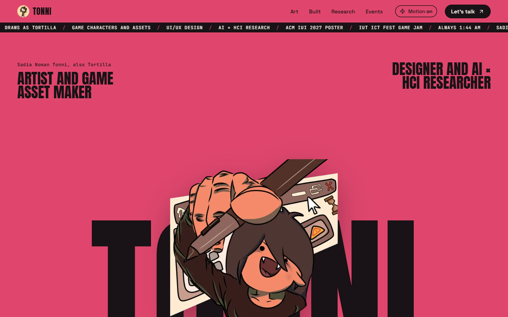

# SNT

### Sadia Noman Tonni — research, design, games and art on one scrolling page

**[tonni19.github.io/SNT](https://tonni19.github.io/SNT/)** · [Art portfolio](https://tortfolio-art.vercel.app/) · [GitHub](https://github.com/tonni19)

I study how people understand, trust and stay in control of AI, and I make the things that sit around that question: interfaces, game art, levels and animation. This site holds all of it in one place, built around my own drawings rather than a template.



---

## The page, top to bottom

| | Section | What it holds |
|---|---|---|
| 01 | **Hero** | My name at poster scale, with my self-portrait standing in it. |
| 02 | **About** | One sentence that reads itself in as you scroll, three short notes and a few honest counts. |
| 03 | **Interests** | Seven research interests, from human-AI interaction to procedural content generation, beside the creative and game work I love. |
| 04 | **Research** | Papers with their arXiv, code and BibTeX links. |
| 05 | **Achievements** | Olympiads, a datathon, competitions and a game jam, in a set order. |
| 06 | **Projects** | Shetu, *A Small Journey*, Tortfolio, Nestly, AppleDHD and UIUNest, each with its live site and code. |
| 07 | **Toolkit** | The tools I use, grouped by what they are for. |
| 08 | **Art** | My drawings on a strip of film. Each frame opens that piece on the art portfolio. |
| 09 | **Say hello** | Email and profiles, and the name rising back up letter by letter. |

A UI/UX lab for case studies is built in and stays hidden until its first entry exists.

## Two switches, both remembered

**Day / Night.** Day is the original rose, cream and plum. Night turns the cream sections and the hero to a warm dark and sets the name in rose. With motion on, the new theme grows out of the switch in a circle. The choice is saved per visitor.

**Motion.** On by default: smooth scrolling, a film strip that pans as you scroll, words that read themselves in, numbers that count up. Off gives a calm page that scrolls normally, with nothing pinned or moving. It switches instantly without reloading, the page stays where you are, and it starts off for anyone whose system asks for reduced motion.

## Design

| | |
|---|---|
| **Colour** | Rose `#e0466d`, cream `#f6f1e7`, plum `#191216`, shared with the art portfolio |
| **Type** | Anton for display, Space Grotesk for text, JetBrains Mono for labels |
| **Icons** | [Lucide](https://lucide.dev), as an inline sprite |
| **Art** | Linked from the art portfolio, never copied, so one source of truth |

## Built with

[Astro](https://astro.build) 7 with typed content collections and TypeScript, `astro:assets` for responsive images, and [GSAP ScrollTrigger](https://gsap.com/docs/v3/Plugins/ScrollTrigger/) with [Lenis](https://github.com/darkroomengineering/lenis) for the scroll scenes. There is no client framework: the page is static HTML and CSS, and the small scripts only add motion and the switches.

```
src/
├── components/   one file per section (Hero, Story, Research, Events, Built, ...)
├── content/      everything that grows: research, achievements, uiux, art.json
├── data/site.ts  everything that rarely changes: name, story, interests, projects, tools, links
├── layouts/      the page shell, fonts and the before-first-paint theme and motion setup
├── scripts/      motion.js (scroll scenes) and ui.js (header, switches, menu)
└── styles/       global.css with the design tokens and both themes
```

## Run it locally

Needs Node.js 22.23 or newer.

```bash
npm install
npm run dev        # http://127.0.0.1:4321/SNT/ with live reload
npm run build      # static site in dist/
npm run preview    # serve the built site
npm run check      # type-check content and code
```

Every push to `main` builds the site and publishes it to GitHub Pages through `.github/workflows/deploy.yml`. The `/SNT/` sub-path comes from `base` in `astro.config.mjs`, and internal links go through `url()` in `src/lib/url.ts`, so renaming the repo means changing one line.

## Adding work

Everything that grows lives in `src/content/`. Each folder has a `_TEMPLATE.md` that explains every field. Files that start with `_` never appear on the site.

| To add | Do this |
|---|---|
| A paper or poster | `npm run new research my-paper`, fill it in and remove `draft: true`. Links such as `arxiv`, `pdf` and `bibtex` appear only once they exist. |
| An achievement | `npm run new achievements event-name`. Set `order` to place it in the list. `learned`, `experience` and `verdict` add a written reflection to its page. |
| A UI/UX case study | `npm run new uiux product-name` with `type: analysis`, `case-study` or `recreation`. The lab appears with the first one. |
| A piece of art | Add it to the Tortfolio repo, then run `npm run sync-art`. It reads `../tortfolio` and rebuilds `src/content/art.json`. Mark a piece `"featured": true` to lead the film strip or `"hidden": true` to leave it out. |
| A project, interest, tool or profile | Edit the lists in `src/data/site.ts`. A profile with no link yet, such as LinkedIn, stays hidden until you add it. |

Content schemas in `src/content.config.ts` check every entry, so a missing field or broken link stops the build with a clear message instead of breaking the page.

**Your own hero art:** swap `heroArt.mascot` (the figure in the name; a transparent PNG or WebP works best) and `heroArt.sticker` in `src/data/site.ts`. Paths that start with `/art/` load from the art portfolio; files in `public/` load from here.

## Accessibility

- Every control is a real button or link with a label, the whole site works from the keyboard, and a skip link jumps past the header.
- Without JavaScript every section still renders, and the film strip becomes a sideways-scrolling row.
- With motion off nothing is pinned, scrubbed or autoplayed.

## Rights

Code © 2026 Sadia Noman Tonni. The artwork is my own, linked from my art portfolio, and may not be reused without permission. Icons from Lucide under the ISC licence.
