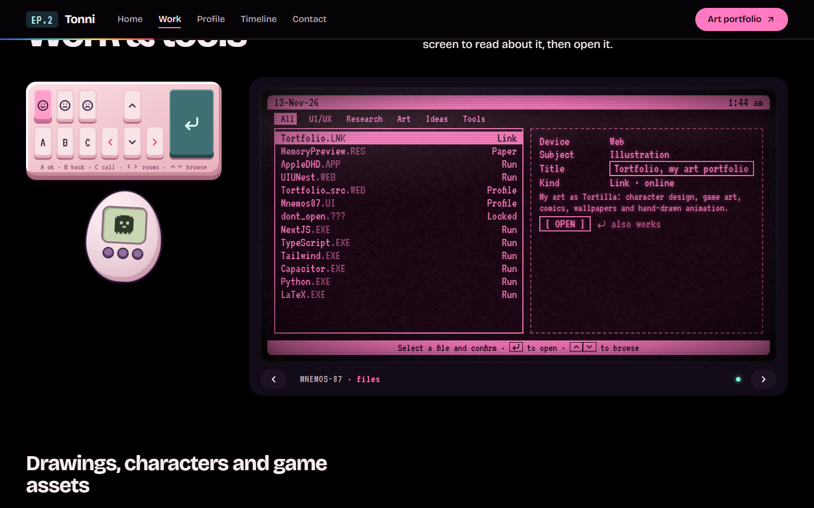
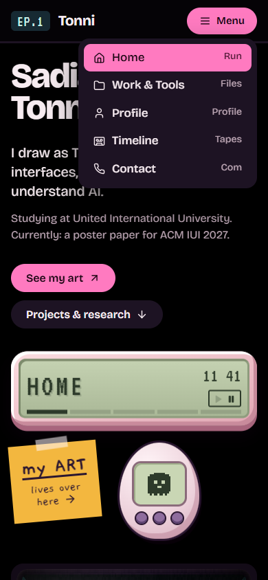

# MNEMOS-87

The personal website of **Sadia Noman Tonni**: artist (as *Tortilla*), game asset creator, UI/UX designer and AI × HCI researcher.

It is a haunted 1987 desk at 1:44 am that you scroll down. Each section has its own CRT monitor, and the objects beside them all work: a keypad, a flip phone, an LCD clock, a memo pad, sticky notes and a small virtual pet that follows you from room to room. The horror is kept quiet: scanlines, a flickering hallway lamp, eyes that follow your cursor, and a few things that notice when you leave.


- **Art portfolio:** [tortfolio-art.vercel.app](https://tortfolio-art.vercel.app/)
- **GitHub:** [github.com/tonni19](https://github.com/tonni19)

## Sections

| Section | What it shows |
|---|---|
| **Home** | Who I am, links to my art, and the hallway screen with a short dialogue |
| **Work & tools** | A GRiD-style file manager of projects, research and tools, plus a wall of my artwork |
| **Profile** | A dossier: interests as stat bars, an about file, and my avatar |
| **Timeline** | A case log of VHS tapes, one per milestone |
| **Contact** | An answering machine with a message form and links |



## Getting around

| Control | What it does |
|---|---|
| Scroll, or the links in the top bar | Move through the sections |
| Chevrons under each screen, on the keypad or on the phone · `←` `→` | Glide to the previous or next section |
| `1` to `5` | Jump straight to a section |
| Keypad up and down, or `↑` `↓` inside the file list | Browse files in Work |
| `Enter` or `A` · `B` · `C` | Confirm · go back · go to Contact |
| The three face keys on the keypad | Change the mood. The frown turns on dread mode |
| Play button on the LCD | Ambient sound, off by default |
| Drag a desk object | Rearrange the desk (desktop). The layout is saved in your browser |
| Double-click the empty wall | Put everything back |

There are a few secrets too. One of the folders is locked.

## Run it locally

There is no build step and nothing to install.

```bash
python -m http.server 8787
# then open http://127.0.0.1:8787
```

To publish it, deploy the folder as-is to any static host (Vercel, Netlify, GitHub Pages).

## Editing content

Everything you would want to change is in [`js/data.js`](js/data.js): name, links, dialogue, profile fields, interests, projects and tools, the art wall, timeline tapes and memo notes. A field set to `null` shows up as a black redaction bar.

The art wall reads its pieces from `art` in `data.js`, with the files in [`assets/art/`](assets/art/). Each piece can be `big`, `tall`, `wide` or a plain square, and an `.mp4` plays as a silent loop.

| File | What it holds |
|---|---|
| [`index.html`](index.html) | Page structure, the markup for each section, and the icon sprite |
| [`css/style.css`](css/style.css) | All styling. Colour, type and layout tokens are at the top in `:root` |
| [`js/main.js`](js/main.js) | Behaviour: scrolling navigation, boot screen, CRT effects, eye tracking, pet, sound, dragging |
| [`js/data.js`](js/data.js) | All content |

### Icons

Every icon is from [Lucide](https://lucide.dev) (ISC licence), kept in one SVG sprite at the top of `index.html`. To use one: `<svg class="i"><use href="#i-arrow-right"/></svg>`. To add one, copy its paths from lucide.dev into a new `<symbol id="i-name" viewBox="0 0 24 24">`.

### Replacing the stand-in drawings

The hallway figure is still a stand-in SVG drawn in code. To keep eye tracking on a new drawing, give each eye a `<g class="eye">` with an `<ellipse>` and a `<circle class="pupil">` inside it.

## Design

- **Type:** Bricolage Grotesque for the page, VT323 only on screens and devices, Gaegu for handwriting on paper.
- **Colour:** a black room, pink plastic devices and magenta CRT phosphor.
- **Motion:** gentle by default. The intense glitches only arrive in dread mode, and everything calms down when the system asks for reduced motion.

## Accessibility

- Every control is a real button or link with a label, and the whole site works from the keyboard.
- With reduced motion turned on, glitches, static, entrances and transitions are switched off.
- Sound only plays after you switch it on.



## Built with

Plain HTML, CSS and JavaScript, with no framework and no dependencies. Fonts come from Google Fonts. Visual references: GRiD Compass system screens and late-80s desk hardware.

## Rights

The code is © 2026 Sadia Noman Tonni. The artwork in `assets/art/` is my own and may not be reused without permission. Icons are from Lucide under the ISC licence.
