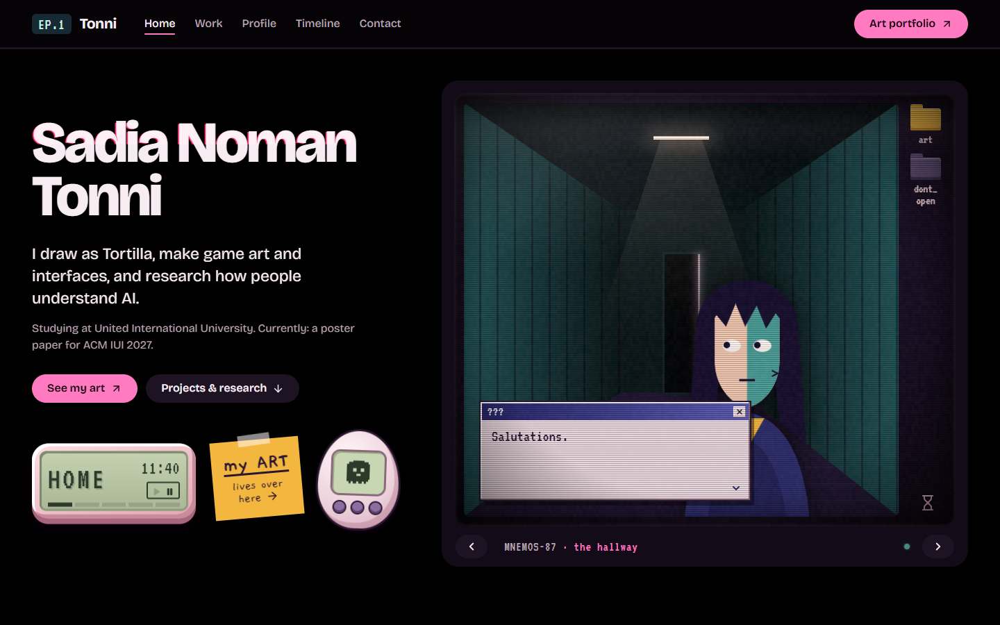

# MNEMOS-87

The personal website of **Sadia Noman Tonni**: artist (as *Tortilla*), game asset creator, UI/UX designer and AI × HCI researcher.

It is a haunted 1987 desk at 1:44 am that you scroll down. Each room has its own CRT monitor, and the desk objects beside them all work: a keypad, a flip phone, an LCD clock, a memo pad, sticky notes and a small virtual pet that follows you from room to room. Behind it all, pink binary rain falls through cold fog and a cat made of digits walks past.



- **Art portfolio:** [tortfolio-art.vercel.app](https://tortfolio-art.vercel.app/)
- **GitHub:** [github.com/tonni19](https://github.com/tonni19)

## Rooms

| Room | What's inside |
|---|---|
| **Home** | Who I am, with the hallway screen and a short dialogue |
| **Work & tools** | A GRiD-style file manager of projects, research and the tools I use, from Clip Studio to Next.js |
| **UI/UX lab** | Shelves for product analyses, case studies and recreations, plus the interfaces I've shipped |
| **Art** | A TV with a channel per art category. Every thumbnail opens that exact piece on the art portfolio |
| **Research** | A card catalogue of papers and posters, with arXiv, Google Scholar, PDF, code and BibTeX links |
| **Achievements & events** | An arcade high-score board: each entry opens to what I learned, the experience, and my verdict |
| **Profile** | A dossier: interests as stat bars, an about file, and my avatar |
| **Timeline** | A case log of VHS tapes, one per milestone |
| **Contact** | An answering machine with a message form and links |

Papers, case studies and achievements each also get their own page, such as `/research/iui-2027-memory-preview/`.

## Run it

Needs Node.js 22.23 or newer.

```bash
npm install
npm run dev        # http://127.0.0.1:4321 (live reload)
npm run build      # static site in dist/
npm run preview    # serve the built site
npm run check      # type-check content and code
```

Deploy `dist/` to any static host. On Vercel or Netlify, import the repo and the Astro preset is picked automatically.

## Adding your work

Everything that grows lives in `src/content/`. Each folder has a `_TEMPLATE.md` that explains every field. Files starting with `_` never show on the site.

| To add | Do this |
|---|---|
| A paper or poster | `npm run new research my-paper`, fill it in, delete `draft: true`. Add `arxiv:`, `scholar:`, `pdf:` and `bibtex:` when they exist; until then the card shows "soon". |
| A UI/UX analysis, case study or recreation | `npm run new uiux product-name`. Set `type:` to `analysis`, `case-study` or `recreation` and it lands on the right shelf. The markdown body becomes the case study page. |
| A competition, jam or event | `npm run new achievements event-name`. Fill in `result`, `learned`, `experience`, `verdict` and an optional `rating` from 1 to 5. |
| A piece of art | Put the image in `src/assets/art/` and add an entry to `src/content/art.json` with its `path` on the art portfolio (for example `/art/portrait/cosmos`). Set `featured: true` to show it on the first channel. |

A ready-made draft for your 2026 game jam is waiting in `src/content/achievements/game-jam-2026.md`.

The schemas in `src/content.config.ts` check every entry. A missing field or a broken link stops `npm run dev` with a clear message instead of breaking the page.

Things that rarely change (name, dialogue, profile, the GRiD file list, the timeline, memo notes) are in `src/data/site.ts`.

## Project structure

| Path | What it holds |
|---|---|
| `src/pages/` | `index.astro` (the desk), plus `research/`, `uiux/` and `achievements/` detail pages and a 404 |
| `src/components/` | One component per room (`HomeRoom`, `ArtRoom`, `ResearchRoom`…), plus `Crt`, `SiteBar`, `SiteFooter`, `Icons` and `Icon` |
| `src/content/` | Papers, case studies, achievements and the art list |
| `src/data/site.ts` | Identity, rooms, dialogue, profile, files, timeline, memo |
| `src/scripts/` | `desk.js` (desk behaviour), `atmosphere.js` (fog, dust, binary rain, cat) and `ui.js` (shared helpers) |
| `src/styles/global.css` | All styling. Colour, type and layout tokens are at the top in `:root` |
| `public/` | Files served as-is: favicon and avatars |

## Getting around

| Control | What it does |
|---|---|
| Scroll, or the links in the top bar | Move through the rooms |
| Chevrons under each screen, on the keypad or on the phone · `←` `→` | Glide to the previous or next room |
| `1` to `9` | Jump straight to a room |
| Up and down on the keypad, or `↑` `↓` in the file list | Browse files in Work |
| Up and down in the art tuner | Change the channel |
| The three face keys on the keypad | Change the mood. The frown turns on dread mode |
| Play button on the LCD | Ambient sound, off by default |
| Drag a desk object | Rearrange the desk (desktop). Saved in your browser |
| Double-click the empty wall | Put everything back |

There are a few secrets too. One of the folders is locked.

## Design

- **Type:** Pixelify Sans for names and headings, Chakra Petch for reading text, VT323 on screens and devices, Gaegu for handwriting on paper.
- **Icons:** [Lucide](https://lucide.dev) (ISC licence) as one SVG sprite in `src/components/Icons.astro`. Use `<Icon name="arrow-right" />`.
- **Motion:** gentle by default; dread mode brings the intense glitches. With reduced motion on, the rain, fog and glitches hold still.

## Accessibility

- Every control is a real button or link with a label, and the whole site works from the keyboard.
- Detail pages work without JavaScript, and so does the art grid (it simply shows every piece).
- Sound only plays after you switch it on.

## Built with

[Astro](https://astro.build) 7 with content collections and TypeScript, optimised images through `astro:assets`, and no client framework. The interactive desk is plain JavaScript.

## Rights

The code is © 2026 Sadia Noman Tonni. The artwork in `src/assets/art/` and `public/assets/art/` is my own and may not be reused without permission. Icons are from Lucide under the ISC licence.
